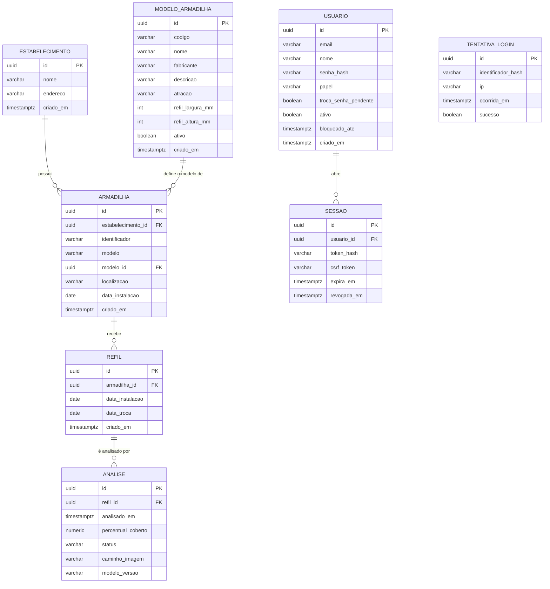

# DATA MODEL — Projeto Integrador

**Versão:** 1.0
**Status:** ATIVO
**Escopo:** modelo de dados, entidades, relacionamentos e regras de
persistência

---

# 1. Objetivo

Especificar o modelo de dados do projeto: entidades, atributos,
relacionamentos e regras de integridade.

---

# 2. Decisão: o banco entra no MVP

A especificação anterior tratava o banco como opcional, sob o argumento de que
o modelo roda de forma stateless. Essa decisão foi revista.

**Motivo:** uma imagem isolada informa apenas o estado atual da armadilha. O
valor de negócio descrito em `../foundation/proposta_individual.md` — permitir
que a empresa saiba quando visitar cada cliente — depende de **série
temporal**, não de leitura pontual. Sem histórico, o sistema é um
classificador de imagem; com histórico, é um sistema de monitoramento capaz de
projetar quando a armadilha saturará.

O custo é baixo: três tabelas no MVP.

---

# 3. Tecnologia

| Item | Escolha | Justificativa |
|---|---|---|
| Banco | PostgreSQL | Dados fortemente relacionais; tipo `timestamptz` adequado à série temporal; é o banco que seria usado em produção, alinhado à intenção de evoluir o projeto |
| Execução | Docker Compose | Elimina divergência de ambiente entre integrantes; instalação no Windows sem atrito |
| ORM | SQLAlchemy | Padrão da indústria Python, documentação vasta. O critério decisivo é prático: em projeto com prazo, qualquer erro tem resposta consolidada disponível |
| Migrations | Alembic | Integração nativa com SQLAlchemy |

## 3.1 Alternativas descartadas

| Alternativa | Motivo |
|---|---|
| SQLite | Atenderia o MVP, mas a migração posterior para PostgreSQL tem atrito real (divergência de tipos e sintaxe) e não sustenta acesso concorrente de múltiplos estabelecimentos |
| MongoDB | Os dados são fortemente relacionais e o volume é pequeno; NoSQL adicionaria complexidade sem resolver problema existente |
| Tortoise ORM | Sintaxe mais limpa e async nativo, mas comunidade pequena e documentação limitada — risco desnecessário sob prazo acadêmico |

## 3.2 Migrations desde a primeira tabela

Toda alteração de schema é feita via migration Alembic, desde a criação
inicial das tabelas — nunca por alteração manual no banco.

O motivo é o trabalho em grupo: sem migrations, um integrante adiciona uma
coluna localmente, o código dele funciona e quebra na máquina dos demais.
Adicionar migrations a um banco já existente é retrabalho evitável.

---

# 4. Escopo por fase

| Entidade | Papel | Fase |
|---|---|---|
| `armadilha` | Unidade física instalada | **MVP** |
| `refil` | Ciclo de vida de um refil, da instalação à troca | **MVP** |
| `analise` | Resultado de uma inferência do modelo | **MVP** |
| `usuario` | Conta com acesso ao sistema | **Hospedagem pública** |
| `sessao` | Sessão autenticada de um usuário | **Hospedagem pública** |
| `tentativa_login` | Registro de tentativas de login, base do bloqueio e do limite por IP | **Hospedagem pública** |
| `estabelecimento` | Cliente onde as armadilhas estão instaladas | Fase 2 |

O `estabelecimento` está especificado abaixo para que o modelo fique completo,
mas sua implementação fica para a fase seguinte — cadastro multi-cliente não é
o foco do MVP.

---

# 5. Diagrama

---

# 6. Entidades

## 6.1 `estabelecimento` (Fase 2)

Cliente onde as armadilhas estão instaladas.

| Campo | Tipo | Regra |
|---|---|---|
| `id` | `uuid` | PK |
| `nome` | `varchar` | Obrigatório |
| `endereco` | `varchar` | Opcional |
| `criado_em` | `timestamptz` | Default `now()` |

## 6.2 `armadilha`

Unidade física instalada em um estabelecimento.

| Campo | Tipo | Regra |
|---|---|---|
| `id` | `uuid` | PK |
| `estabelecimento_id` | `uuid` | **Não existe no MVP.** Adicionada, junto com a tabela `estabelecimento` e a FK, por migration da Fase 2 — uma FK para tabela inexistente não pode ser criada |
| `identificador` | `varchar` | Código legível para identificar a unidade em campo. **Único** (`UNIQUE`) — sustenta o erro `IDENTIFICADOR_DUPLICADO` de `../api/api_spec.md`, seção 2.3 |
| `modelo` | `varchar` | Nome do modelo, copiado do catálogo no cadastro (ex.: `StickFly K-45`). Preservado para armadilhas sem vínculo |
| `modelo_id` | `uuid` | FK opcional para `modelo_armadilha.id`, `ON DELETE RESTRICT`. A API recebe só este campo e deriva `modelo` do catálogo |
| `localizacao` | `varchar` | Descrição do ponto de instalação |
| `data_instalacao` | `date` | |
| `removida_em` | `timestamptz` | Nulo enquanto a armadilha está ativa. Preenchido pela remoção lógica; o histórico (refis, análises, imagens) permanece |
| `foto_identificacao` | `bytea` | Foto real da armadilha, reduzida a 800 px no maior lado, em JPEG e sem metadados (EXIF). Nulo usa a foto padrão do modelo. Carregamento adiado: a listagem nunca lê esta coluna |
| `foto_atualizada_em` | `timestamptz` | Instante do último envio da foto; nulo quando vale a foto padrão. Versiona a URL da imagem para invalidar o cache |
| `criado_em` | `timestamptz` | Default `now()` |

## 6.3 `refil`

Ciclo de vida de um refil adesivo, da instalação até a troca.

**Esta é a entidade que sustenta a análise temporal.** Quando um refil é
trocado, o percentual de cobertura volta a zero. Sem separar os ciclos, a
série temporal de uma armadilha ficaria descontínua e sem sentido — seria
impossível responder "quanto tempo este refil levou para saturar".

| Campo | Tipo | Regra |
|---|---|---|
| `id` | `uuid` | PK |
| `armadilha_id` | `uuid` | FK, obrigatório |
| `data_instalacao` | `date` | Obrigatório |
| `data_troca` | `date` | Nulo enquanto o refil estiver ativo |
| `criado_em` | `timestamptz` | Default `now()` |

**Regra de integridade:** uma armadilha deve ter no máximo um refil ativo
(`data_troca IS NULL`) por vez.

## 6.4 `analise`

Resultado de uma inferência do modelo sobre uma imagem.

| Campo | Tipo | Regra |
|---|---|---|
| `id` | `uuid` | PK |
| `refil_id` | `uuid` | FK, obrigatório |
| `analisado_em` | `timestamptz` | Momento da inferência |
| `percentual_coberto` | `numeric(5,2)` | 0,00 a 100,00 |
| `status` | `varchar` | `ok`, `atencao` ou `trocar` |
| `caminho_imagem` | `varchar` | Caminho relativo do arquivo, não o binário |
| `imagem_original`, `mascara` | `bytea` | Nulos no armazenamento em disco. Preenchidos somente com `STORAGE_BACKEND=database` (hospedagem sem disco durável) |
| `modelo_versao` | `varchar` | Versão do modelo no formato `semver+hash` — ver seção 7.2 |

## 6.5 `usuario`

Conta com acesso ao sistema. O gerente cria operadores pela interface e a CLI
administra contas e papéis; não há cadastro aberto (`login.md`, 5.4).

| Campo | Tipo | Regra |
|---|---|---|
| `id` | `uuid` | PK |
| `email` | `varchar` | Obrigatório, **único**; normalizado (minúsculas, NFKC, sem espaços nas pontas) |
| `nome` | `varchar` | Obrigatório; usado na exibição |
| `papel` | `varchar` | Obrigatório; operador (padrão) ou gerente; gerente único |
| `troca_senha_pendente` | `boolean` | Padrão false; true em criação pela API |
| `senha_hash` | `varchar` | String PHC do Argon2id (carrega algoritmo, parâmetros e sal); **nunca** a senha |
| `ativo` | `boolean` | Padrão `true`; `false` bloqueia o login e revoga as sessões |
| `bloqueado_ate` | `timestamptz` | Nulo; preenchido no bloqueio temporário por tentativas |
| `senha_alterada_em` | `timestamptz` | Auditoria |
| `ultimo_login_em` | `timestamptz` | Nulo até o primeiro login |
| `criado_em` | `timestamptz` | Padrão `now()` |

Usuários nunca são excluídos: são **desativados**, para preservar a auditoria.

A conta tem papel varchar NOT NULL DEFAULT 'operador', CHECK
papel IN ('gerente', 'operador') e índice único parcial sobre papel WHERE
papel = 'gerente'. Inclui contas desativadas e permite zero gerentes.
troca_senha_pendente boolean NOT NULL DEFAULT false é true nas contas
criadas pela API e só é limpa após troca de senha válida. A migração
preserva contas existentes como operadores sem troca pendente.
A aplicação lê papel e flag do banco por requisição, sem guardá-los na
tabela sessao.

## 6.6 `sessao`

Sessão autenticada. O token entregue ao navegador **nunca** é gravado: só o seu
SHA-256 (`login.md`, 7.1), para que um vazamento do banco não entregue sessões
utilizáveis.

| Campo | Tipo | Regra |
|---|---|---|
| `id` | `uuid` | PK |
| `usuario_id` | `uuid` | FK, obrigatório |
| `token_hash` | `varchar(64)` | SHA-256 do token em hexadecimal, **único** |
| `csrf_token` | `varchar` | Token CSRF sincronizado, vinculado à sessão |
| `criado_em` | `timestamptz` | Padrão `now()`; base da duração absoluta |
| `ultimo_uso_em` | `timestamptz` | Base da inatividade; atualizado com frequência limitada |
| `expira_em` | `timestamptz` | Fim absoluto da sessão |
| `revogada_em` | `timestamptz` | Nulo enquanto válida; preenchido no logout e nas revogações |
| `ip` | `varchar` | Auditoria |
| `user_agent` | `varchar` | Auditoria |

Sessões expiradas são removidas na inicialização e a cada login do usuário.

## 6.7 `tentativa_login`

Base do bloqueio por conta e do limite por IP (`login.md`, 6.3). Não guarda o
e-mail digitado nem a senha, para não registrar senhas escritas no campo errado.

| Campo | Tipo | Regra |
|---|---|---|
| `id` | `uuid` | PK |
| `identificador_hash` | `varchar` | Hash do e-mail normalizado |
| `ip` | `varchar` | Endereço de origem (do proxy confiável) |
| `ocorrida_em` | `timestamptz` | Padrão `now()` |
| `sucesso` | `boolean` | Falhas contam para o limite; o sucesso zera o contador da conta |

Registros com mais de 24 horas podem ser removidos.

## 6.8 `modelo_armadilha`

Catálogo dos modelos fabricados, pré-cadastrado e escolhido ao registrar uma
armadilha. Não é editável pela API: cada modelo novo entra por migração,
como o StickFly K-45 (migração `0004`).

| Campo | Tipo | Regra |
|---|---|---|
| `id` | `uuid` | PK |
| `codigo` | `varchar` | Identificador estável, **único** (ex.: `stickfly-k45`) |
| `nome` | `varchar` | Nome exibido (ex.: `StickFly K-45`) |
| `fabricante` | `varchar` | Obrigatório |
| `descricao` | `varchar` | Opcional |
| `atracao` | `varchar` | Opcional (ex.: `UV-A`) |
| `refil_largura_mm`, `refil_altura_mm` | `integer` | Dimensões do refil em milímetros; `CHECK` ambos maiores que zero. Permitem converter percentual em área física |
| `ativo` | `boolean` | Padrão verdadeiro. Modelo desativado não aceita novos cadastros, mas as armadilhas existentes o mantêm |
| `criado_em` | `timestamptz` | Padrão `now()` |

---

# 7. Regras de persistência

## 7.1 Armazenamento de imagens

Por padrão, as imagens **não** são armazenadas no banco. O campo
`caminho_imagem` guarda uma referência relativa a um diretório do sistema de
arquivos. Em hospedagem sem disco durável (função serverless), a variável
`STORAGE_BACKEND=database` grava a imagem e a máscara nas colunas
`imagem_original` e `mascara`; o valor padrão é `filesystem`.

Armazenar binários em PostgreSQL incha o banco, complica o backup e degrada a
performance de consultas que não precisam da imagem — que é a maioria.

**Localização:** `data/uploads/`, montado como **volume Docker** a partir do
host. O volume é obrigatório: arquivos gravados dentro do container são
perdidos quando ele é recriado.

**Retenção:** no MVP, todas as imagens são preservadas. Na escala do projeto
(dezenas de armadilhas, uma análise diária) o volume é irrelevante. Uma versão
de produção precisaria de política de expurgo, o que está fora deste escopo.

## 7.2 Rastreabilidade do modelo

O campo `analise.modelo_versao` é obrigatório e registra qual versão do modelo
produziu cada resultado.

Isso atende diretamente o princípio de reprodutibilidade definido em
`.context/rules/ai_development_rules.md`, seção 9.1. Sem esse campo, após um
retreino não haveria como distinguir resultados produzidos por modelos
diferentes, invalidando qualquer comparação histórica.

**Formato:** `semver+hash`, por exemplo `v1.2.0+a3f9c2e1`.

- O **semver** é definido manualmente e serve à comunicação — é o que aparece
  no relatório e nas discussões do grupo.
- O **hash** são os primeiros 8 caracteres do SHA-256 do arquivo de pesos,
  calculado automaticamente no carregamento do modelo.

A combinação existe porque cada parte cobre uma falha da outra: o semver
sozinho depende de alguém lembrar de incrementá-lo a cada retreino — se
esquecer, dois modelos distintos recebem a mesma identificação e o campo perde
a função. O hash sozinho é infalível, mas ilegível para discussão.

## 7.3 Derivação do status

O campo `status` é derivado de `percentual_coberto` segundo os limiares
definidos em `../foundation/project_overview.md`, seção 7.2. É persistido — e
não calculado sob demanda — justamente porque os limiares podem ser
recalibrados: uma análise deve preservar o status vigente no momento em que
foi feita.

## 7.4 Restrições e índices do MVP

Restrições declaradas no banco, não apenas validadas na aplicação — o banco é
a última barreira contra dado inconsistente.

| Tabela | Restrição / índice | Motivo |
|---|---|---|
| todas | `id uuid` com default `gen_random_uuid()` | Identificador gerado pelo banco |
| todas | `criado_em timestamptz` com default `now()` | Conforme as seções 6.2 a 6.4 |
| `armadilha` | `UNIQUE (identificador)` | Erro `IDENTIFICADOR_DUPLICADO` da API |
| `armadilha` | FK `modelo_id` → `modelo_armadilha.id`, `ON DELETE RESTRICT` | Um modelo em uso não pode ser apagado |
| `modelo_armadilha` | `UNIQUE (codigo)` e `CHECK (refil_largura_mm > 0 AND refil_altura_mm > 0)` | Catálogo consistente |
| `refil` | FK `armadilha_id` → `armadilha.id`, `ON DELETE RESTRICT` | Não há exclusão de armadilha no MVP; RESTRICT impede apagar histórico por acidente |
| `refil` | `CHECK (data_troca IS NULL OR data_troca >= data_instalacao)` | Um refil não é trocado antes de instalado |
| `refil` | índice em `armadilha_id` | Consulta do refil ativo e do histórico por armadilha |
| `analise` | FK `refil_id` → `refil.id`, `ON DELETE RESTRICT` | Mesmo motivo |
| `analise` | `CHECK (percentual_coberto BETWEEN 0 AND 100)` | Regra da seção 6.4 |
| `analise` | `CHECK (status IN ('ok', 'atencao', 'trocar'))` | Valores da seção 6.4; sem acento, conforme a seção 7.3 |
| `analise` | índice em `(refil_id, analisado_em)` | Série temporal por refil, ordenada — a consulta central do sistema |
| `usuario` | `UNIQUE (email)` | Uma conta por e-mail normalizado |
| `usuario` | CHECK papel IN ('gerente', 'operador') | Recusa outros papéis |
| `usuario` | UNIQUE (papel) WHERE papel = 'gerente' | No máximo um gerente, inclusive desativado |
| `sessao` | FK `usuario_id` → `usuario.id`, `ON DELETE RESTRICT` | Usuários são desativados, não excluídos |
| `sessao` | `UNIQUE (token_hash)` e `CHECK (token_hash ~ '^[0-9a-f]{64}$')` | O banco só aceita o SHA-256 em hexadecimal, nunca o token em claro |
| `sessao` | índice em `(usuario_id, revogada_em)` | Consulta das sessões ativas e do limite por usuário |
| `tentativa_login` | índices em `(identificador_hash, ocorrida_em)` e `(ip, ocorrida_em)` | Contagem de falhas na janela, por conta e por IP |

A regra de **um refil ativo por armadilha** (seção 6.3) **não** faz parte da
migration inicial: é a task DB03, em migration própria.

---

# 8. Consultas que o modelo precisa sustentar

O schema foi desenhado para responder:

- Qual o estado atual de cada armadilha (última análise do refil ativo)?
- Quanto tempo este refil levou para saturar?
- Qual a taxa média de saturação por armadilha, em pontos percentuais por dia?
- Quais armadilhas devem ser visitadas nos próximos N dias, dada a taxa
  observada?

A última consulta é a que entrega o valor de negócio descrito na proposta.

---

# 9. Infraestrutura

Divisão entre o que roda em container e o que roda nativamente:

| Componente | Execução |
|---|---|
| PostgreSQL | Docker |
| Backend (FastAPI) | Docker |
| Frontend (React) | Docker |
| **Treino do modelo** | **Nativo ou Colab — fora do Docker** |

O treino fica fora do Docker deliberadamente: GPU passthrough via WSL2 no
Windows funciona, mas o esforço de configuração não se justifica. O treino é
um processo offline que produz um arquivo de pesos, e esse arquivo é montado
como volume no container do backend.

---

# 10. Decisões registradas

| Decisão | Escolha | Seção |
|---|---|---|
| Banco no MVP | Sim — `armadilha`, `refil`, `analise`, `modelo_armadilha` (catálogo) | 2, 4, 6.8 |
| SGBD | PostgreSQL em Docker | 3 |
| ORM | SQLAlchemy | 3 |
| Migrations | Alembic, desde a primeira tabela | 3.2 |
| Armazenamento de imagem | Filesystem em volume Docker, caminho no banco | 7.1 |
| Retenção de imagem | Preservar tudo no MVP | 7.1 |
| Formato de `modelo_versao` | `semver+hash` | 7.2 |
| Campo `metadados` (`jsonb`) | **Descartado** — ver abaixo | — |

## 10.1 Sobre o campo `metadados` descartado

Um campo `jsonb` genérico foi considerado para registrar dados adicionais do
modelo (tempo de inferência, confiança da máscara) sem exigir migration.

Foi descartado por representar abstração prematura, contrariando o princípio
de "preferir soluções simples a abstrações prematuras" das regras do projeto.
Campos genéricos tendem a acumular chaves não documentadas e se tornar
ilegíveis com o tempo.

Caso a necessidade se concretize durante a pesquisa, o campo apropriado é
adicionado via migration — que é exatamente o cenário para o qual as
migrations existem.

---

# 11. Pendências

Nenhuma pendência de decisão. Itens de implementação:

- [ ] Escrever a migration inicial das três tabelas do MVP
- [ ] Implementar cálculo do hash do arquivo de pesos no carregamento do
      modelo

---

# FIM DO DATA MODEL
