# QA DO MODELO — Comparação de máscaras do treino
**Versão:** 1.0
**Status:** ATIVO
**Escopo:** evidências visuais de seis imagens do conjunto de treino

---

# 1. Objetivo

Comparar gabaritos com previsões do modelo E1 `v0.1.0-e1+a982b9a5`. A
imagem 1 é a analisada anteriormente; as cinco demais foram sorteadas em
faixas diferentes de cobertura. Todas são imagens de **treino**: esta
amostra não mede generalização nem substitui avaliação no conjunto de teste
ou em fotos reais.

A máscara rosa é a previsão do modelo sobreposta à imagem original. A cobertura
prevista divide os pixels cobertos pela placa prevista; o gabarito usa a placa
do dataset. Os percentuais de identificação e precisão são calculados por
pixel, em 768 × 576, ignorando pixels 255 do gabarito. Identificação (recall)
é a parcela dos pixels de insetos encontrados; precisão é a parcela dos
pixels marcados que consta como inseto no gabarito.

---

# 2. Imagens e máscaras

## 2.1 Imagem 1 e máscara 1

Amostra `amostra_001950`; base `real_ums`.

- Cobertura no gabarito: **48.38%**.
- Cobertura prevista pelo modelo: **48.85%**.
- Pixels de insetos identificados: **92.32%**.
- Precisão dos pixels marcados: **91.24%**.
- Pixels: 113865 acertos, 9468 não identificados e 10934 falsos positivos.

**Imagem 1**

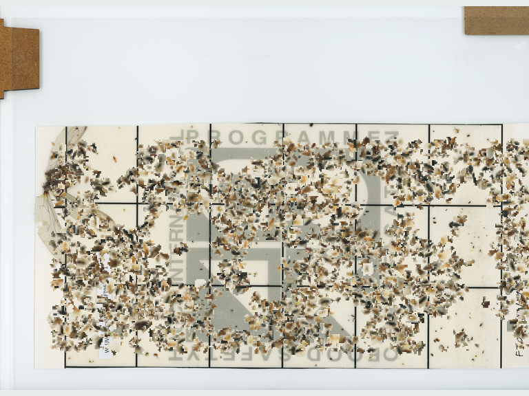

**Máscara 1 — previsão do modelo**

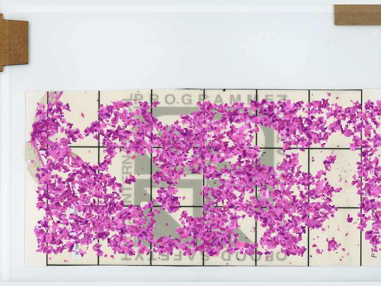

## 2.2 Imagem 2 e máscara 2

Amostra `amostra_001936`; base `real_ums`.

- Cobertura no gabarito: **3.86%**.
- Cobertura prevista pelo modelo: **3.92%**.
- Pixels de insetos identificados: **93.49%**.
- Precisão dos pixels marcados: **93.26%**.
- Pixels: 10304 acertos, 717 não identificados e 745 falsos positivos.

**Imagem 2**

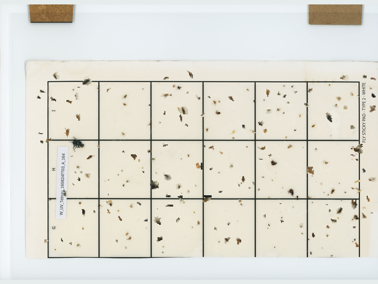

**Máscara 2 — previsão do modelo**

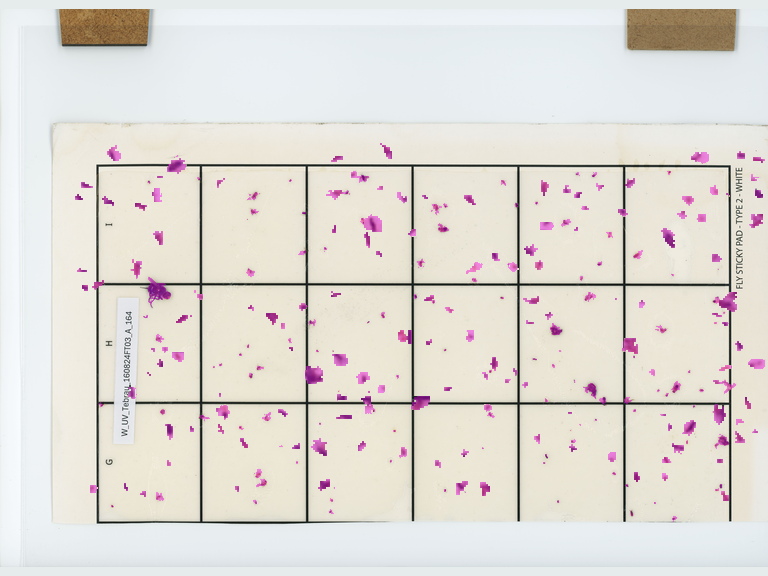

## 2.3 Imagem 3 e máscara 3

Amostra `amostra_001846`; base `real_ums`.

- Cobertura no gabarito: **6.72%**.
- Cobertura prevista pelo modelo: **6.65%**.
- Pixels de insetos identificados: **93.57%**.
- Precisão dos pixels marcados: **94.78%**.
- Pixels: 18258 acertos, 1254 não identificados e 1005 falsos positivos.

**Imagem 3**

**Máscara 3 — previsão do modelo**

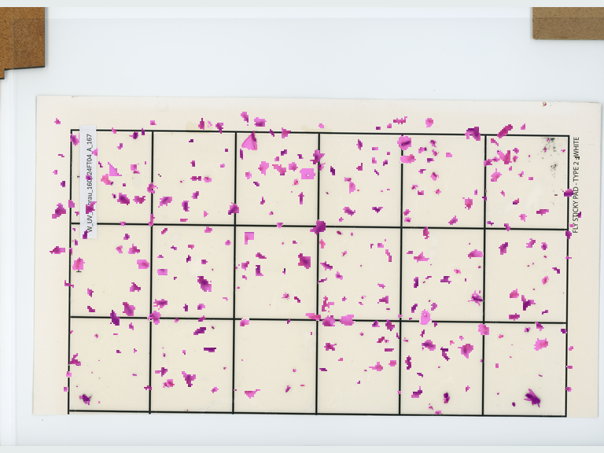

## 2.4 Imagem 4 e máscara 4

Amostra `amostra_002560`; base `real_ums`.

- Cobertura no gabarito: **19.60%**.
- Cobertura prevista pelo modelo: **19.32%**.
- Pixels de insetos identificados: **95.30%**.
- Precisão dos pixels marcados: **96.66%**.
- Pixels: 54258 acertos, 2677 não identificados e 1875 falsos positivos.

**Imagem 4**

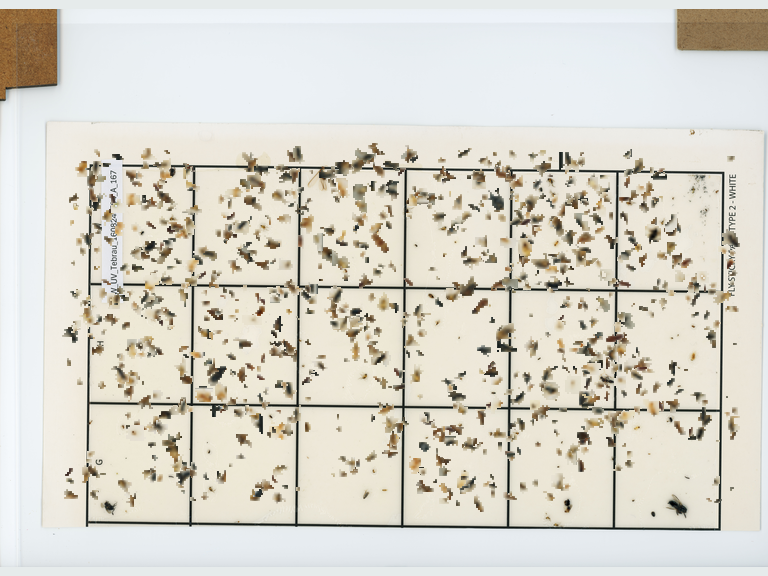

**Máscara 4 — previsão do modelo**

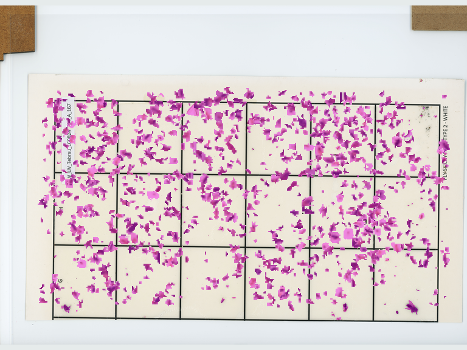

## 2.5 Imagem 5 e máscara 5

Amostra `amostra_002176`; base `real_ums`.

- Cobertura no gabarito: **23.96%**.
- Cobertura prevista pelo modelo: **23.42%**.
- Pixels de insetos identificados: **94.35%**.
- Precisão dos pixels marcados: **96.51%**.
- Pixels: 64465 acertos, 3862 não identificados e 2333 falsos positivos.

**Imagem 5**

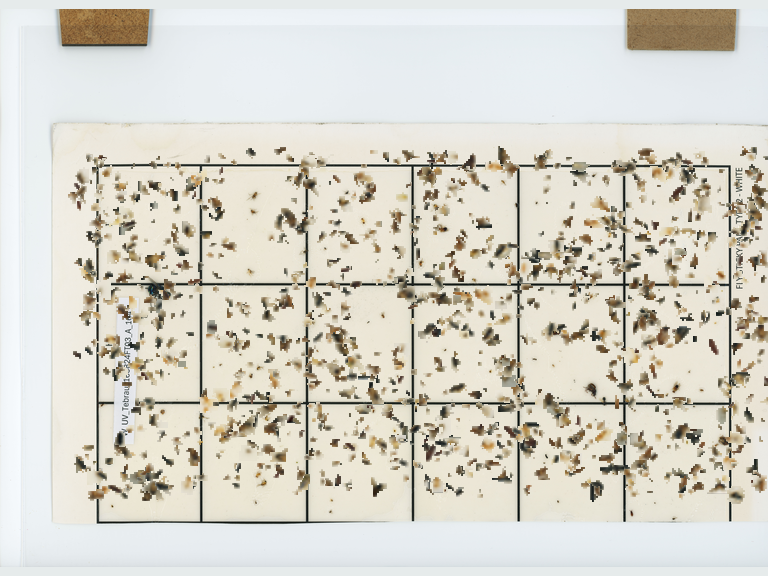

**Máscara 5 — previsão do modelo**

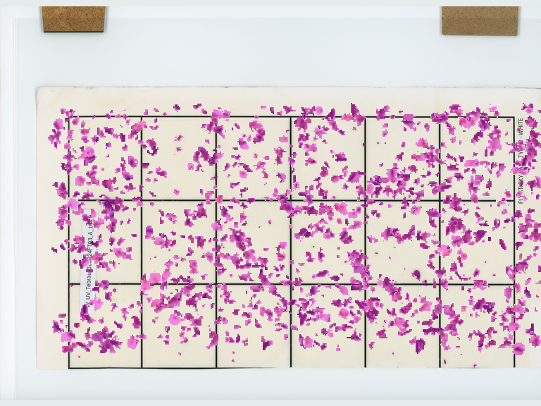

## 2.6 Imagem 6 e máscara 6

Amostra `amostra_002676`; base `real_ums`.

- Cobertura no gabarito: **34.33%**.
- Cobertura prevista pelo modelo: **33.65%**.
- Pixels de insetos identificados: **95.02%**.
- Precisão dos pixels marcados: **96.88%**.
- Pixels: 94781 acertos, 4963 não identificados e 3050 falsos positivos.

**Imagem 6**

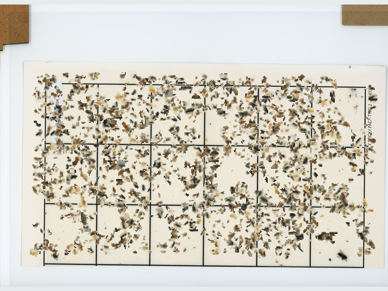

**Máscara 6 — previsão do modelo**

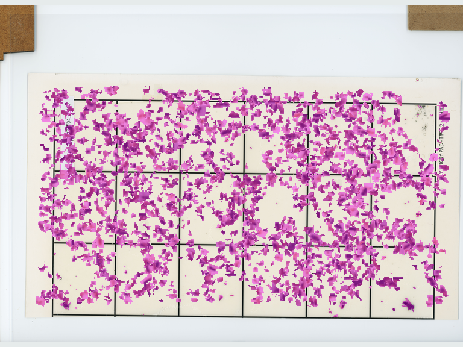

---

# FIM DO QA DO MODELO
