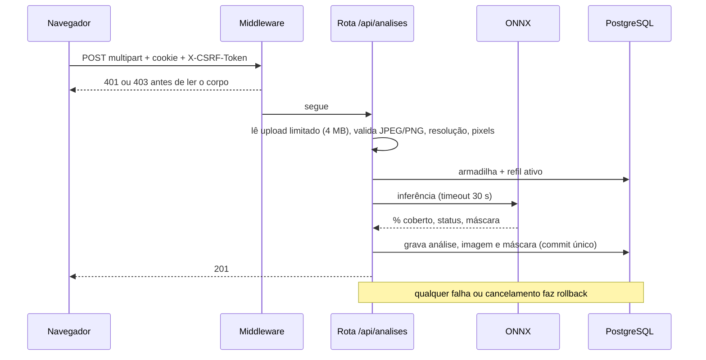
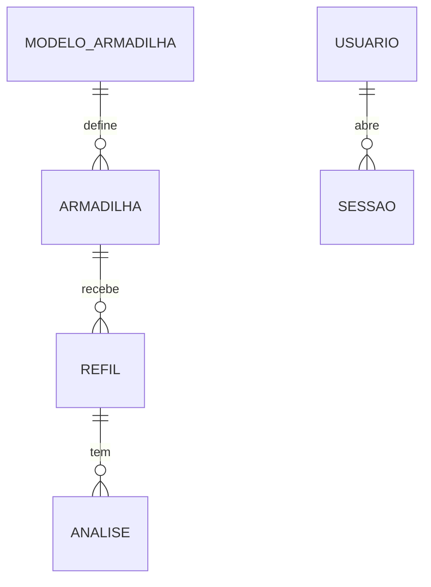

# TrapSight: requisitos, regras de negócio e fluxos

Conferido diretamente no código do backend e do frontend em 03/11/2026. Onde a especificação em `.context/plan` diverge do código, vale o código.

## 1. Requisitos funcionais

| ID | Requisito |
|---|---|
| RF01 | Login e logout por e-mail e senha (`/api/auth/login`, `/api/auth/logout`). `GET /api/auth/me` devolve o usuário, o papel e o `csrf_token`. |
| RF02 | O gerente cria operadores definindo a senha inicial (`POST /api/usuarios`) e lista as contas (`GET /api/usuarios`). Não há cadastro aberto. |
| RF03 | A conta criada nasce com troca de senha pendente. Enquanto pendente, só `me`, `senha` e `logout` funcionam (`POST /api/auth/senha`). |
| RF04 | Cadastro, edição e remoção de armadilha, com modelo escolhido no catálogo (`/api/modelos-armadilha`). O refil inicial é opcional no cadastro (`criar_refil_inicial`). |
| RF05 | Foto de identificação da armadilha (`PUT/GET/DELETE /api/armadilhas/{id}/foto`). |
| RF06 | Análise de foto (`POST /api/analises`, multipart): devolve o percentual coberto e o status. Durante a análise, a tela mostra uma barra de progresso estimada que vai a 100% quando a resposta chega (a API não informa o andamento real). |
| RF07 | Consulta da análise e do arquivo (`GET /api/analises/{id}`, `/imagem`, `/mascara`). A interface mostra por padrão a imagem com a máscara do modelo (área coberta em magenta) e oferece o botão "Ver foto original"; se a máscara faltar, cai para a foto enviada. |
| RF08 | Painel (`GET /api/armadilhas`): percentual atual, status, última análise, dias até saturar, "em alerta desde" e dias em uso. A lista já vem ordenada por urgência (ver RN14), e o painel de alertas destaca as armadilhas em alerta. |
| RF09 | Histórico (`GET /api/armadilhas/{id}/analises`) com `escopo=refil_ativo` ou `completo`, `refil_id` e `limite` de 1 a 1000 (padrão 100). |
| RF10 | Troca de refil (`POST /api/armadilhas/{id}/refis`) com a data de instalação do novo ciclo. |
| RF11 | Administração por linha de comando (`src/cli.py`): `criar-usuario`, `definir-papel`, `redefinir-senha`, ativar/desativar, `desbloquear` e `listar-usuarios`. |
| RF12 | Telas: `/login`, `/` (painel), `/armadilhas/nova`, `/armadilhas/:id`, `/armadilhas/:id/editar`, `/analises/nova`, `/conta/senha` e `/contas` (só gerente). |
| RF13 | Seed de demonstração (`src/seed_demo.py`). |
| RF14 | Exibir o resultado como índice de saturação do refil, em que o limiar de troca vale 80% (ver RN15). **Implementado** (tarefa FRONT-SAT01, commit `ca8bb51`): cartão, resumo do refil, lista de análises, quadro da análise e gráfico mostram a saturação; a tela de resultado mantém a cobertura real em texto menor. |

A máscara é gerada e gravada pela inferência e agora aparece na interface (decisão de 03/11/2026, que reverteu a de 30/10). O timelapse continua fora do escopo.

## 2. Requisitos não funcionais

### Inferência
- **RNF01:** U-Net exportada para ONNX e executada com `onnxruntime`. A entrada é redimensionada para 768 × 576, com normalização ImageNet.
- **RNF02:** a inferência tem timeout de 30 s. Em caso de falha, a transação é revertida e os arquivos gravados são removidos.
- **RNF03:** o modo de inferência é configurável (`stub`, `modelo` ou `onnx`), assim como o armazenamento (`filesystem` ou `database`).

### Segurança
- **RNF04:** Argon2id para as senhas. Política de senha: de 8 a 128 caracteres, com ao menos uma letra e um número (alterada em 03/11/2026; antes eram 15 caracteres sem regra de composição), normalização NFC. Recusa senhas comuns, triviais (sequências e repetições) e derivadas do e-mail ou do nome.
- **RNF05:** sessão com token guardado como hash no banco e `csrf_token`. Expira após 30 min de inatividade ou 8 h no total, com no máximo 5 sessões por usuário.
- **RNF06:** o middleware exige sessão, CSRF e `Origin` antes de ler o corpo de qualquer rota `/api`. Um anônimo não consegue enviar um upload inteiro antes de receber 401.
- **RNF07:** o login sempre executa o Argon2, mesmo para conta inexistente, para não revelar quais contas existem. A resposta de falha é única.
- **RNF08:** 5 falhas por conta em 15 min bloqueiam a conta por 15 min. Falhar durante o bloqueio não o estende. Há também um limite de 30 falhas por IP em 15 min. Esses contadores ficam no banco (`tentativa_login`).
- **RNF09:** o limite de 30 análises por minuto por usuário e o de 20 contas por hora por gerente são em memória, por instância. Em ambiente serverless (Vercel) valem por instância, não de forma global.
- **RNF10:** o upload aceita só JPEG ou PNG, validado pela assinatura e pela decodificação. Limites: 4 MB, pelo menos 512 px no maior lado e limite de pixels contra *decompression bomb*. O corpo é lido em blocos de 64 KB.
- **RNF11:** o banco tem RLS nas tabelas, papel `trapsight_backend` sem login e papel `trapsight_runtime` com login. `auditoria_cli` não permite UPDATE nem DELETE.
- **RNF12:** CORS por origem configurada e cabeçalhos de segurança em duas camadas:
  - Backend (middleware): `X-Content-Type-Options: nosniff` em tudo e `Cache-Control: no-store` nas respostas de autenticação.
  - Vercel (`vercel.json`): `X-Content-Type-Options`, `X-Frame-Options: DENY`, `Referrer-Policy: strict-origin-when-cross-origin`, `Permissions-Policy` (geolocalização, câmera e microfone desligados) e `Strict-Transport-Security` (`max-age=63072000; includeSubDomains`).
  - CSP: `Content-Security-Policy-Report-Only` em todos os hosts; a CSP imposta (`Content-Security-Policy`) vale só para o host de Preview da branch `dev`, até a verificação no navegador.

### Qualidade
- **RNF13:** erros com código estável. A integridade fica no banco: `UNIQUE(identificador)`, `UNIQUE(email)`, `CHECK` de datas e de percentual, `ON DELETE RESTRICT` nas chaves. São 13 migrações Alembic.
- **RNF14:** data civil no fuso `America/Sao_Paulo`.

## 3. Regras de negócio

- **RN01, status:** abaixo de 10% é `ok`, de 10% a 20% inclusive é `atencao` e acima de 20% é `trocar`. Os limiares são configuráveis e a ordem 0 < atenção < trocar ≤ 100 é validada.
- **RN02, cobertura:** `pixels placa_coberta × 100 ÷ (pixels placa_coberta + pixels placa_limpa)`, arredondado a 0,01 (ROUND_HALF_UP). O fundo não entra no cálculo.
- **RN03, placa não detectada:** se a área da placa (limpa + coberta) for menor que 5% da imagem de 768 × 576, a análise falha com `PLACA_NAO_DETECTADA`.
- **RN04, análise:** exige armadilha existente e refil ativo, senão devolve `ARMADILHA_NAO_ENCONTRADA` ou `REFIL_ATIVO_INEXISTENTE`. Imagem, inferência e gravação ocorrem numa única transação.
- **RN05, refil ativo único:** é o refil com `data_troca IS NULL`, com índice único parcial no banco. `data_troca >= data_instalacao` é garantido por `CHECK`.
- **RN06, troca de refil:** atômica, com bloqueio da linha da armadilha (`FOR UPDATE`). Encerra o ciclo ativo (se houver) com `data_troca` igual à data de instalação do novo e cria o novo ciclo. A resposta traz `dias_ate_troca` do ciclo encerrado e `dias_em_uso` do novo. Recusa data futura e troca anterior à instalação do ciclo atual. Em armadilha sem refil, apenas cria o ciclo.
- **RN07, previsão de saturação:** regressão linear por mínimos quadrados sobre todas as medições do refil ativo, com o dia zero na data de instalação. Exige pelo menos 2 medições e tendência crescente, senão devolve `null`. Se a última medição já passou do limiar de troca, devolve 0. Nos demais casos, devolve o piso dos dias restantes, nunca menor que 0.
- **RN08, alerta:** `em_alerta_desde` é a primeira medição acima do limiar de troca, enquanto a última leitura continuar acima dele.
- **RN09, remoção:** lógica (`removida_em`). O histórico permanece.
- **RN10, papéis:** só o gerente cria e lista contas (`403` para operador). Existe no máximo um gerente, garantido por índice único parcial (`papel = 'gerente'`). Contas criadas pela API são sempre operador, e campos extras como papel são recusados.
- **RN11, e-mail:** normalizado e único. Colisões por caixa ou por Unicode contam como duplicidade.
- **RN12, troca de senha pendente:** bloqueia todas as rotas autenticadas, exceto `me`, `senha` e `logout`.
- **RN13, auditoria:** eventos de autenticação (`login_ok`, `login_falhou`, `login_bloqueado`, `conta_criada` e outros) vão para o log (stdout) no formato `auth.<evento>`, sem dados sensíveis. As ações de administração por CLI são gravadas na tabela `auditoria_cli`. Não há endpoint para o gerente consultar a auditoria.
- **RN14, ordem do painel:** a ordenação é feita no backend. Primeiro vêm as armadilhas com status `trocar`; depois as que têm previsão de saturação, da mais próxima para a mais distante; por último as sem previsão (`null`). O desempate é pelo identificador. O status `atencao` não tem prioridade própria: entra pela previsão.
- **RN15, índice de saturação (apresentação):** o frontend passa a mostrar `índice = cobertura ÷ limiar de troca × 80`, limitado a 0..100. Com o limiar padrão de 20%, a tabela oficial é: 5% → 20%, 10% → 40%, 20% → 80%, 25% ou mais → 100%. Vale só na tela: a API, o banco, o modelo, o status e a previsão continuam usando a cobertura real. A tela de resultado mantém a cobertura real visível ("X% da placa coberta"). Rótulo adotado: "Saturação do refil".
- **RN16, origem dos limiares:** os limiares de 10% e 20% foram validados e adotados como definitivos em 03/11/2026, junto com a apresentação em índice de saturação (RN15); a pendência `EXT02` está encerrada. A troca é pensada por critério higiênico, não por a cola estar cheia. Uma primeira calibração previa 40% e 70% e foi descartada por irreal frente ao conjunto público usado (cobertura mediana de cerca de 5,6%, máximo de 27%). Subir o limiar de troca exige cuidado: o dataset de treino vai de 0% a 54% de cobertura e não tem imagem acima de 60%, então status acima disso não foi validado.

## 4. Fluxo de usuário

```mermaid
flowchart TD
    A[Login] --> B{Troca de senha pendente?}
    B -->|sim| C[/conta/senha] --> D
    B -->|não| D[Painel /]
    D --> E[/armadilhas/nova: modelo, refil inicial opcional, foto]
    D --> F[/analises/nova: armadilha, foto, % e status]
    D --> G[/armadilhas/:id: gráfico, histórico, previsão, trocar refil, editar, remover]
    D --> H[/contas: só gerente, cria operador]
```

## 5. Fluxo da API

### Análise de uma foto



### Login
1. Limite por IP (30 falhas em 15 min).
2. Busca da conta pelo e-mail normalizado.
3. Argon2 sempre executado, contra um hash fictício se a conta não existe.
4. Registro da tentativa em `tentativa_login`.
5. Bloqueio da conta ao atingir 5 falhas na janela.
6. Em caso de sucesso, criação da sessão (máximo de 5 por usuário) e cookie `HttpOnly`.

## 6. Fluxo de banco

Tabelas: `modelo_armadilha`, `armadilha`, `refil`, `analise`, `usuario`, `sessao`, `tentativa_login`, `auditoria_cli`. A tabela `estabelecimento` não existe, pois é da Fase 2.



| Operação | O que acontece no banco |
|---|---|
| Cadastro de armadilha | `INSERT` em `armadilha` e, se pedido, em `refil`, na mesma transação. `modelo` é copiado do catálogo. |
| Análise | `INSERT` em `analise` com `refil_id`. Imagem e máscara ficam em `bytea` com `STORAGE_BACKEND=database`, ou em disco no modo `filesystem`. |
| Troca de refil | Bloqueia a armadilha, `UPDATE refil SET data_troca` no ciclo ativo e `INSERT` do novo. |
| Remoção | `UPDATE armadilha SET removida_em`. |
| Login | `INSERT` em `tentativa_login` e `UPDATE` do bloqueio em `usuario`. A sessão fica em `sessao` com `token_hash`, `csrf_token`, expiração e revogação. |
| Acesso | A aplicação usa `trapsight_runtime`, que herda `trapsight_backend`, com RLS ligado. As migrações rodam com o administrador. |

## 7. Códigos HTTP dos erros (conferidos em `src/api/erros.py`)

| Código | HTTP |
|---|---|
| `ARMADILHA_NAO_ENCONTRADA`, `ANALISE_NAO_ENCONTRADA`, `ROTA_NAO_ENCONTRADA` | 404 |
| `REFIL_ATIVO_INEXISTENTE`, `IDENTIFICADOR_DUPLICADO`, `EMAIL_JA_CADASTRADO` | 409 |
| `ARQUIVO_AUSENTE`, `FORMATO_NAO_SUPORTADO`, `RESOLUCAO_INSUFICIENTE`, `REQUISICAO_INVALIDA` | 400 |
| `ARQUIVO_MUITO_GRANDE` | 413 |
| `VALIDACAO_FALHOU`, `SENHA_FRACA` | 422 |
| `NAO_AUTENTICADO`, `CREDENCIAIS_INVALIDAS` | 401 |
| `CSRF_INVALIDO`, `ACESSO_NEGADO`, `TROCA_DE_SENHA_OBRIGATORIA` | 403 |
| `METODO_NAO_PERMITIDO` | 405 |
| `LIMITE_TENTATIVAS`, `LIMITE_ANALISES`, `LIMITE_CONTAS` | 429 |
| `PLACA_NAO_DETECTADA`, `FALHA_INFERENCIA`, `ERRO_INTERNO` | 500 |

`PLACA_NAO_DETECTADA` devolve 500, e não um código 4xx, mesmo sendo uma falha causada pela foto enviada. Vale considerar um 422 no futuro.

## 8. Pendências conhecidas

- Modelo ONNX no ar: ativado no Preview e verificado com três imagens do conjunto de teste (cobertura prevista a menos de 1 ponto percentual do valor conhecido, cerca de 5 s por análise). A ativação em produção está descrita na seção 10.
- Faltam as linhas de referência do gráfico (40% e 80%) conferidas no navegador: os testes automatizados não desenham o gráfico.
- Limites de análise e de criação de conta só valem por instância (RNF09). Para valer globalmente, precisam de armazenamento compartilhado.
- Validar o modelo em fotos reais (hoje só imagens sintéticas) e criar subconjuntos de robustez.

## 9. Não conferido

- O conteúdo de cada política de RLS.
- O efeito da CSP no navegador (violações no console), ainda por verificar.

## 10. Estado no ar (03/11/2026)

| Item | Estado |
|---|---|
| Versão | `v0.1.0` (tag Git de 03/11/2026, registrada no `CHANGELOG.md`). |
| Código | Branches `dev` e `main` no commit `ca8bb51` (índice de saturação e inferência ONNX) na data deste registro; a `v0.1.0` inclui também a máscara, a barra de progresso e a nova regra de senha. |
| Produção | `trapsight-pi3.vercel.app`, deploy da `main`. `INFERENCE_MODE=onnx`, `MODEL_VERSION=v0.1.0-e1`, `MODEL_WEIGHTS_PATH` vazio (usa o ONNX empacotado). |
| Preview | Deploy da `dev` com as mesmas variáveis, protegido pela autenticação da Vercel. Usa o banco de homologação. |
| Pacote Python | 280,9 MB (limite de 500 MB). As dependências são instaladas na primeira chamada de uma instância fria (cerca de 2 s). |
| Modelo | `v0.1.0-e1+a982b9a5`, SHA-256 do ONNX `f8416cd3…`, avaliado só em imagens sintéticas. |

**Verificação feita no Preview e em produção** (três imagens do conjunto de teste, enviadas pela API com conta de teste; a armadilha criada foi removida ao final):

| Imagem | Cobertura real | Cobertura prevista | Status | Tempo |
|---|---|---|---|---|
| `amostra_000003` | 7,74% | 7,66% | ok | 5,4 s |
| `amostra_000004` | 8,42% | 8,55% | ok | 5,5 s |
| `amostra_000025` | 33,95% | 33,25% | trocar | 5,0 s |

O tempo de cerca de 5 s por análise vem de uma instância já aquecida e com uma thread de inferência. A primeira análise depois de um período parado deve ser mais lenta.
