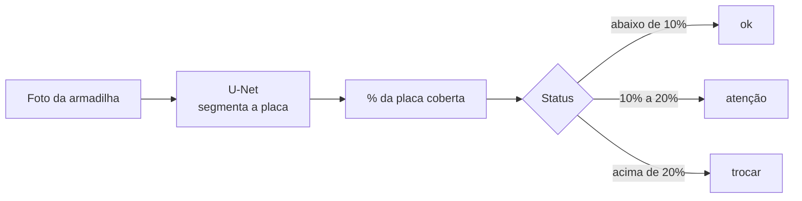

# TrapSight

**Visão computacional para medir a saturação de armadilhas adesivas e prever a hora de trocar o refil.**

[](CHANGELOG.md)
[](LICENSE)


> [!NOTE]
> Protótipo funcional em validação, desenvolvido como Projeto Integrador de Sistemas Inteligentes III na Fatec "Shunji Nishimura", Pompeia. O modelo foi avaliado apenas em imagens sintéticas; a validação com fotos de campo ainda não foi feita.

## Instalar no celular


Abra o [TrapSight](https://trapsight-pi3.vercel.app) pelo link ou pelo QR code.

- **Android (Chrome):** toque em **Instalar aplicativo** em Configurações ou em **Instalar** na faixa do login. Se o convite não aparecer, procure **Instalar aplicativo** ou **Adicionar à tela inicial** no menu do Chrome.
- **iPhone (Safari):** toque em **Compartilhar → Adicionar à Tela de Início** e confirme. O iPhone não oferece o mesmo diálogo automático do Android.

Abra pelo ícone na tela inicial para usar uma janela própria, sem barra de endereço. O visual instalado prevê navegação inferior no celular e cabeçalho compacto, com as mesmas telas e os mesmos fluxos.

**A análise precisa de internet.** Offline, só o casco (a estrutura visual do aplicativo) pode abrir após um acesso conectado; não há análise, fila de envio nem notificações. As fotos continuam pelo seletor de arquivos: use as [fotos homologadas da demonstração](#demonstração), pois imagens acima de 4 MB são recusadas. O modo offline e o acabamento visual estão em integração; a instalação em Android e iPhone ainda aguarda a verificação final.

## O problema e a solução

Empresas de controle de pragas mantêm armadilhas adesivas em mercados e açougues e decidem a troca do refil **olhando a placa**, sem critério objetivo. Trocar cedo gera deslocamento e refil desperdiçado; trocar tarde deixa a armadilha saturada e sem eficácia. O problema foi levantado com uma empresa real do setor, parceira do projeto.

O TrapSight recebe a **foto da armadilha**, mede **quanto da placa já está coberta por insetos**, classifica a situação e **estima em quantos dias ela vai saturar**.



A cobertura é calculada **sobre a placa detectada**, não sobre a foto inteira, então não depende do enquadramento. Na tela, o resultado aparece como **saturação do refil**: o limiar de troca (20% de cobertura) vale 80%. A cobertura real continua visível no resultado.

## O que entrega

- **Análise por imagem** (JPEG ou PNG, até 4 MB) com saturação, cobertura real, status e barra de progresso.
- **Painel** que mostra primeiro as armadilhas que pedem ação, com a foto da última análise.
- **Histórico, gráfico e previsão** de dias até a saturação, por regressão linear sobre todas as medições.
- **Ciclo do refil:** registro de trocas e da duração de cada ciclo.
- **Contas por papel:** o gerente cria e exclui operadores; senhas com Argon2id, sessão protegida e limites de uso.

## Resultados e limites do modelo

Medidos em 450 imagens **sintéticas** de teste (insetos reais recompostos sobre placas), nunca vistas no treino. U-Net com encoder ResNet34 pré-treinado, exportada em ONNX (93 MB, em [`backend/models/`](backend/models/)).

| Métrica | U-Net | Baseline clássico (OpenCV) |
| --- | --- | --- |
| Dice da classe "placa coberta" | **0,966** | 0,835 |
| Erro médio da cobertura | **0,24 p.p.** | 3,34 p.p. |
| Acurácia do status (ok, atenção, trocar) | **99,3%** | 72,7% |
| "Trocar" lido como "ok" | **0** | 0 |

**Uso pretendido:** apoiar a decisão de troca do refil da armadilha StickFly K-45, com fotos em que a placa aparece inteira e de frente, como nas imagens de treino.

**Fora do escopo e limites:** outros modelos de armadilha, identificação de espécies, fotos em que a placa ocupa menos de 5% da imagem e qualquer decisão sem inspeção humana. O desempenho em fotos reais, com outra luz, ângulo ou reflexo, é desconhecido.

## Demonstração

**Site:** <https://trapsight-pi3.vercel.app>

| Campo | Valor |
| --- | --- |
| E-mail | `teste-operador@example.test` |
| Senha | `To-ekOLLoc9KATubjmoCXuyeHQIY669cpcJmAAm` |

**Fotos para testar** (com gabarito do resultado esperado): [pasta no Google Drive](https://drive.google.com/drive/folders/1LM5Ic8GyqEot9uloRpY9bP8apuJfk5iB?usp=drive_link). São 10 imagens sintéticas, de 2% a 45% de cobertura.

1. Entre com a conta acima.
2. Em **Cadastrar armadilha**, escolha o modelo StickFly K-45 e marque o refil inicial.
3. Em **Nova análise**, envie uma das fotos e compare o resultado com o `gabarito.csv`.

> [!WARNING]
> É um ambiente de demonstração com **dados fictícios** em planos gratuitos. Não envie fotos pessoais ou sensíveis: as imagens ficam guardadas no banco. Qualquer visitante pode trocar a senha da conta de teste ou bloqueá-la por tentativas erradas; se isso acontecer, avise o mantenedor. O primeiro acesso depois de um tempo parado pode demorar, porque o banco gratuito pausa por inatividade.

## Executar localmente

Pré-requisito: [Docker Desktop](https://www.docker.com/products/docker-desktop/).

```bash
# 1. variáveis de ambiente (edite a senha do banco e repita-a em backend/.env)
cp .env.example .env
cp backend/.env.example backend/.env
cp frontend/.env.example frontend/.env

# 2. sobe banco, API e frontend, e cria as tabelas
docker compose up --build -d
docker compose exec backend python -m alembic upgrade head

# 3. cria o gerente (o comando pede a senha: 8 caracteres ou mais, com letras e números)
docker compose exec backend python -m src.cli criar-usuario \
  --email gerente@exemplo.com --nome "Gerente" --papel gerente
```

Abra <http://localhost:5173> (a documentação interativa da API fica em <http://localhost:8000/docs>). Por padrão a API devolve um resultado simulado; para usar o **modelo real**, defina `INFERENCE_MODE=onnx`, `MODEL_VERSION=v0.1.0-e1` e `MODEL_WEIGHTS_PATH=` (vazio) no `backend/.env`.

O [guia de execução](.context/docs/EXECUCAO.md) cobre o resto: desenvolvimento sem Docker, dados de demonstração, treino do modelo, publicação e problemas comuns.

## Testes

Não há CI automático (o projeto tem um só mantenedor), então os testes rodam localmente:

```bash
scripts/testar-backend.sh        # backend: testes em contêiner, com banco descartável
cd frontend && npm test          # frontend: testes; também npm run lint e npm run build
```

## Documentação

| Documento | Conteúdo |
| --- | --- |
| [`.context/docs/EXECUCAO.md`](.context/docs/EXECUCAO.md) | Como executar, testar, treinar e publicar |
| [`.context/docs/ARQUITETURA.md`](.context/docs/ARQUITETURA.md) | Arquitetura, decisões técnicas, tecnologias e situação das etapas |
| [`.context/plan/README.md`](.context/plan/README.md) | Especificações do projeto: modelo de dados, API, telas, modelo e avaliação |
| [`deploy/vercel-supabase.md`](deploy/vercel-supabase.md) | Publicação na Vercel e no Supabase |
| [`security/README.md`](security/README.md) | Testes de segurança |
| [`CHANGELOG.md`](CHANGELOG.md) | Histórico de versões |

## Contribuir, suporte e segurança

- **Dúvidas e problemas:** abra uma [*issue*](https://github.com/plfrancisco/trapsight-pi3/issues).
- **Contribuições:** leia o [`CONTRIBUTING.md`](CONTRIBUTING.md).
- **Vulnerabilidades:** não abra *issue*; siga o [`SECURITY.md`](SECURITY.md).

## Créditos e dados

O banco de sprites usa observações do iNaturalist no Brasil e dois conjuntos públicos sob a licença CC BY 4.0:

- Ong & Lim (2025). *An annotated image dataset of urban insects for computer vision and deep learning*. Figshare. [doi:10.6084/m9.figshare.28280792.v1](https://doi.org/10.6084/m9.figshare.28280792.v1)
- Colares, Peres & Dambros (2025). *5-fold dataset for deep learning training using insect images from sticky traps in Central Amazon*. Figshare. [doi:10.6084/m9.figshare.28688198](https://doi.org/10.6084/m9.figshare.28688198)

Essas licenças valem para os dados originais, não para o código. O catálogo de sprites e o dataset de treino não fazem parte do repositório. O nome da empresa parceira é mantido em sigilo a pedido do grupo.

## Mantenedor

**Pedro Lucas Francisco**, Tecnologia em Sistemas Inteligentes, Fatec Pompeia.

## Licença

[MIT](LICENSE). Veja também a nota sobre os dados em [Créditos e dados](#créditos-e-dados).
