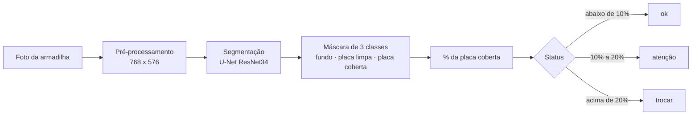
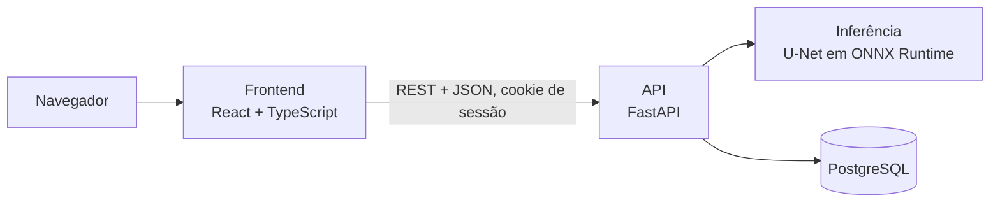

# TrapSight

**Visão computacional para medir a saturação de armadilhas adesivas e prever a hora de trocar o refil.**

[](https://github.com/plfrancisco/trapsight-pi3/actions/workflows/ci.yml)


O TrapSight analisa a foto de uma armadilha adesiva de mosquito, calcula **quanto da superfície já está coberta por insetos** e **estima em quantos dias ela vai saturar**, trocando a inspeção visual por um critério objetivo.

> Projeto Integrador de Sistemas Inteligentes III, Fatec "Shunji Nishimura", Pompeia. **Protótipo funcional em validação.**

**Demonstração online:** <https://trapsight-pi3.vercel.app>. O acesso exige login e não há cadastro aberto. As contas de teste, com dados fictícios, são fornecidas pela equipe. O banco usa um plano gratuito que pode estar pausado por inatividade.

## Sumário

- [O problema](#o-problema)
- [A solução](#a-solução)
- [Funcionalidades](#funcionalidades)
- [Resultados do modelo](#resultados-do-modelo)
- [Arquitetura](#arquitetura)
- [Decisões técnicas](#decisões-técnicas)
- [Stack](#stack)
- [Início rápido](#início-rápido)
- [Estrutura do repositório](#estrutura-do-repositório)
- [Documentação](#documentação)
- [Qualidade e segurança](#qualidade-e-segurança)
- [Status e próximos passos](#status-e-próximos-passos)
- [Créditos e dados](#créditos-e-dados)
- [Autor](#autor)

## O problema

Empresas de controle de pragas mantêm armadilhas adesivas em mercados e açougues e decidem a troca do refil por **inspeção visual**, sem critério objetivo. O resultado é um custo duplo:

- **Troca antecipada:** deslocamento da equipe e refil descartado com vida útil sobrando;
- **Troca tardia:** armadilha saturada, sem eficácia no controle de pragas.

O problema foi levantado com uma empresa real do setor, parceira do projeto. O impacto financeiro ainda não foi quantificado.

## A solução



O percentual é calculado **sobre a placa detectada**, e não sobre a foto inteira, então não depende do enquadramento. Além da leitura pontual, o sistema guarda o histórico de cada armadilha e **projeta quantos dias faltam para a saturação**, permitindo planejar a visita em vez de reagir a ela.

Na tela, o resultado aparece como **saturação do refil**, um índice em que o limiar de troca vale 80% (cobertura de 5%, 10%, 20% e 25% aparece como 20%, 40%, 80% e 100%). A cobertura real da placa continua disponível no resultado da análise.

## Funcionalidades

- **Análise por imagem:** envio da foto (JPEG ou PNG), percentual de saturação, cobertura real da placa e status;
- **Painel operacional:** armadilhas ordenadas por urgência, miniatura da última foto e painel de alertas, com navegação adaptada para celular;
- **Histórico e projeção:** evolução por refil e previsão de dias até a saturação por regressão linear sobre todas as medições;
- **Ciclo de vida do refil:** registro de trocas, com a duração de cada ciclo;
- **Catálogo de modelos de armadilha:** o cadastro oferece o catálogo do fabricante (o primeiro é o StickFly K-45, com as dimensões do refil) e uma foto de identificação, real ou padrão do modelo;
- **Acesso por login:** contas criadas por um gerente, com papéis (gerente e operador), troca obrigatória da senha inicial, sessão em cookie `HttpOnly`, proteção contra CSRF e senhas com Argon2id.

## Resultados do modelo

Conjunto de teste de 450 imagens, **sintéticas** (recomposição de insetos reais sobre placas), nunca vistas no treino. Execução `e1` (U-Net com encoder ResNet34 pré-treinado).

| Métrica | U-Net | Baseline clássico (OpenCV) |
| --- | --- | --- |
| Dice da classe "placa coberta" | **0,966** | 0,835 |
| Erro médio da cobertura | **0,24 p.p.** | 3,34 p.p. |
| Erro máximo da cobertura | 1,27 p.p. | 7,34 p.p. |
| Acurácia do status (ok, atenção, trocar) | **99,3%** | 72,7% |
| "Trocar" classificado como "ok" | **0** | 0 |

O modelo atingiu o alvo dos critérios definidos antes do treino (Dice ≥ 0,90, erro médio ≤ 1,0 p.p. e nenhum "trocar" lido como "ok"). **Esses números valem apenas para imagens sintéticas.** A validação com fotos reais da empresa parceira ainda não foi feita, e a aprovação geral segue pendente até lá. O modelo exportado (ONNX, 93 MB) está em [`backend/models/`](backend/models/), junto com seus metadados.

## Arquitetura



Em **desenvolvimento**, o Docker Compose sobe o banco, a API e o frontend. Em **produção**, o frontend e a API vão juntos para a Vercel (a API como função Python, com o modelo ONNX empacotado) e o banco fica no Supabase (PostgreSQL), acessado pelo pooler de transações. O treino do modelo roda fora do contêiner, numa máquina com GPU.

## Decisões técnicas

| Decisão | Por quê |
| --- | --- |
| **Medir área coberta em vez de contar insetos** | Insetos colados se sobrepõem; a área é um indicador mais robusto de saturação |
| **Segmentação em 3 classes** (fundo, placa limpa, placa coberta) | O percentual é calculado sobre a placa, então o resultado não depende do enquadramento |
| **Dataset sintético primeiro, dados reais depois** | Não há base pública deste cenário com máscaras por pixel. As máscaras nascem junto com a imagem, a cobertura real é conhecida com exatidão e o sistema inteiro pode ser validado antes de haver fotos de campo |
| **Sprites de insetos brasileiros de fotos com licença aberta** | Observações do iNaturalist no Brasil e conjuntos públicos CC BY 4.0, com autor e licença de cada foto registrados |
| **Avaliação separada em sintético e real** | A distância entre as duas métricas mede o *domain gap* |
| **Baseline clássico (OpenCV) como comparação** | Mostra com evidência onde o modelo treinado supera um limiar de brilho |
| **Transfer learning** (ResNet34 pré-treinado) | Viabiliza o treino com um dataset pequeno |
| **Inferência em ONNX Runtime** | Reduz o pacote e dispensa o PyTorch em produção; um teste confere a paridade com o checkpoint |
| **Projeção por regressão sobre todas as medições** | Usar só a primeira e a última leitura amplifica o ruído |
| **Regras no banco, não só na aplicação** | Restrições, chaves e um índice único parcial garantem no máximo um refil ativo por armadilha, mesmo com acessos concorrentes |
| **Erros padronizados com códigos estáveis** | O frontend decide o comportamento pelo código do erro, nunca pelo texto |

## Stack

| Camada | Tecnologia |
| --- | --- |
| Modelo | Python, PyTorch, `segmentation_models_pytorch`, OpenCV, Albumentations, ONNX Runtime |
| Backend | FastAPI, SQLAlchemy, Alembic, Pydantic |
| Banco de dados | PostgreSQL (Supabase em produção) |
| Frontend | React, TypeScript, Vite, Tailwind CSS, Recharts |
| Infraestrutura | Docker, Docker Compose, Caddy (HTTPS no ambiente de testes de segurança), Vercel, Supabase |
| Qualidade | Ruff, pytest, ESLint, Vitest, GitHub Actions |
| Segurança | OWASP ZAP, Nuclei e uma suíte própria de testes de invasão |

## Início rápido

Pré-requisito: [Docker Desktop](https://www.docker.com/products/docker-desktop/).

```bash
# 1. variáveis de ambiente (edite a senha do banco e repita-a em backend/.env)
cp .env.example .env
cp backend/.env.example backend/.env
cp frontend/.env.example frontend/.env

# 2. sobe banco, API e frontend, e cria as tabelas
docker compose up --build -d
docker compose exec backend python -m alembic upgrade head

# 3. cria o gerente (o comando pede a senha, de 15 caracteres ou mais)
docker compose exec backend python -m src.cli criar-usuario \
  --email gerente@exemplo.com --nome "Gerente" --papel gerente
```

| Serviço | Endereço |
| --- | --- |
| Frontend | <http://localhost:5173> |
| API (documentação interativa) | <http://localhost:8000/docs> |

Por padrão a API usa um resultado simulado (`INFERENCE_MODE=stub`). Para rodar o **modelo real**, defina `INFERENCE_MODE=onnx`, `MODEL_VERSION=v0.1.0-e1` e `MODEL_WEIGHTS_PATH=` (vazio) no `backend/.env`.

**Guia completo:** [`docs/EXECUCAO.md`](docs/EXECUCAO.md). Ele cobre a configuração detalhada, o desenvolvimento sem Docker, os testes, os dados de demonstração, o treino e a exportação do modelo, a publicação e os problemas comuns.

## Estrutura do repositório

```text
backend/        API FastAPI, migrações Alembic, testes, treino do modelo e modelo ONNX
frontend/       Interface React + TypeScript
deploy/         Publicação (Vercel + Supabase), proxy Caddy, backup e restauração
security/       Suíte de testes de segurança e pentest
scripts/        Testes do backend em contêiner, backup e verificação de migrações
docs/           Guia de execução
.context/       Especificações, tarefas e evidências de QA
apresentacao/   Material de apoio para o vídeo de apresentação
app.py          Ponto de entrada da Vercel (API e frontend na mesma origem)
vercel.json     Cabeçalhos de segurança e configuração dos serviços na Vercel
```

## Documentação

| Documento | Conteúdo |
| --- | --- |
| [`docs/EXECUCAO.md`](docs/EXECUCAO.md) | Como executar, testar, treinar e publicar |
| [`.context/plan/README.md`](.context/plan/README.md) | Índice das especificações: visão geral, modelo de dados, contrato da API, telas, pipeline do modelo e avaliação |
| [`.context/validation/qa_evidencias/requisitos_regras_e_fluxos.md`](.context/validation/qa_evidencias/requisitos_regras_e_fluxos.md) | Requisitos, regras de negócio e fluxos conferidos no código |
| [`deploy/vercel-supabase.md`](deploy/vercel-supabase.md) | Publicação na Vercel e no Supabase |
| [`deploy/backup-restauracao.md`](deploy/backup-restauracao.md) | Backup e restauração do banco |
| [`security/README.md`](security/README.md) | Testes de segurança |
| [`backend/README.md`](backend/README.md) | Dados de demonstração |
| [`backend/training/README.md`](backend/training/README.md) | Gerador de dataset sintético e importação de sprites |

## Qualidade e segurança

O CI do GitHub Actions roda a cada push e pull request: lint, formatação, migrações e testes do backend; tipos, lint e testes do frontend; e a verificação das migrações com o papel de produção.

A segurança entrou no projeto desde o começo:

- acesso só com login; contas criadas por um gerente; senha de 15 a 128 caracteres, guardada com Argon2id;
- bloqueio da conta após tentativas erradas, limite de falhas por IP e limite de análises por usuário;
- validação do upload pela assinatura e pela decodificação, com limites de tamanho e de pixels;
- banco com permissões mínimas e RLS; só a aplicação fala com ele;
- cabeçalhos de segurança, CSRF e CORS por origem configurada;
- testes de invasão automatizados antes de cada publicação (relatório final ainda em andamento).

## Status e próximos passos

| Etapa | Situação |
| --- | --- |
| Especificação técnica (arquitetura, modelo, API, telas, avaliação) | Concluída |
| Ambiente de desenvolvimento e Docker Compose | Concluída |
| Banco de dados (esquema, migrações, regras de integridade) | Concluída |
| API (endpoints, upload, histórico e projeção de saturação) | Concluída |
| Interface web (painel, cadastro, nova análise, detalhe da armadilha) | Concluída |
| Login, papéis e proteção da sessão | Concluída |
| Gerador de dataset sintético e banco de sprites | Concluída |
| Treino e avaliação do modelo em imagens sintéticas | Concluída |
| Publicação (Vercel e Supabase) com o modelo real | Concluída |
| Testes de invasão (relatório final) | Em andamento |
| Validação com fotos reais da empresa parceira e ajuste fino | Não iniciada |
| Confirmação dos limiares de status com a empresa parceira | Pendente |

**Limitações conhecidas:**

- o modelo só foi medido em imagens sintéticas; o desempenho em fotos de campo é desconhecido;
- os limiares de 10% e 20% são um ponto de partida e precisam ser confirmados com a empresa parceira;
- não há subconjuntos de teste de robustez (iluminação, ângulo, reflexo);
- a análise roda em CPU e leva cerca de 5 segundos por foto, mais na primeira chamada depois de um período parado;
- as fotos são enviadas manualmente, sem câmera instalada em campo;
- os limites de análises por minuto e de contas por hora valem por instância do servidor, não de forma global.

## Créditos e dados

O banco de sprites usa observações do iNaturalist no Brasil e dois conjuntos públicos, ambos sob a licença CC BY 4.0:

- Ong & Lim (2025). *An annotated image dataset of urban insects for computer vision and deep learning*. Figshare. [doi:10.6084/m9.figshare.28280792.v1](https://doi.org/10.6084/m9.figshare.28280792.v1)
- Colares, Peres & Dambros (2025). *5-fold dataset for deep learning training using insect images from sticky traps in Central Amazon*. Figshare. [doi:10.6084/m9.figshare.28688198](https://doi.org/10.6084/m9.figshare.28688198)

O nome da empresa parceira é mantido em sigilo a pedido do grupo. O catálogo de sprites e o dataset de treino não fazem parte do repositório.

## Autor

**Pedro Lucas Francisco**, Tecnologia em Sistemas Inteligentes, Fatec Pompeia.
