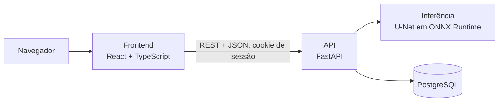
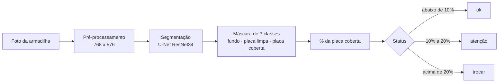

# Arquitetura e decisões técnicas

Este documento explica **como o TrapSight é construído e por quê**. Para executar o projeto, veja o [guia de execução](EXECUCAO.md). As especificações completas (modelo de dados, contrato da API, telas, pipeline do modelo e avaliação) estão em [`.context/plan/`](../.context/plan/README.md).

## Visão geral



Fluxo de uma análise:



O percentual é calculado **sobre a placa detectada**, e não sobre a foto inteira. O histórico de cada armadilha alimenta uma regressão linear que projeta os dias até a saturação.

**Índice de saturação.** Na tela, o resultado aparece como *saturação do refil*: o limiar de troca (20% de cobertura) vale 80%, e coberturas de 5%, 10%, 20% e 25% aparecem como 20%, 40%, 80% e 100%. É só apresentação: a API, o banco e o modelo usam a cobertura real.

## Ambientes

- **Desenvolvimento:** o Docker Compose sobe o banco, a API e o frontend.
- **Produção:** o frontend e a API vão juntos para a Vercel (a API como função Python, com o modelo ONNX empacotado) e o banco fica no Supabase (PostgreSQL), acessado pelo pooler de transações. O passo a passo está em [`deploy/vercel-supabase.md`](../deploy/vercel-supabase.md).
- **Treino do modelo:** roda fora do contêiner, numa máquina com GPU.

## Decisões técnicas

| Decisão | Por quê |
| --- | --- |
| **Medir área coberta em vez de contar insetos** | Insetos colados se sobrepõem; a área é um indicador mais robusto de saturação |
| **Segmentação em 3 classes** (fundo, placa limpa, placa coberta) | O percentual é calculado sobre a placa, então o resultado não depende do enquadramento |
| **Dataset sintético primeiro, dados reais depois** | Não há base pública deste cenário com máscaras por pixel. As máscaras nascem junto com a imagem, a cobertura real é conhecida com exatidão e o sistema inteiro pode ser validado antes de haver fotos de campo |
| **Sprites de insetos brasileiros de fotos com licença aberta** | Observações do iNaturalist no Brasil e conjuntos públicos CC BY 4.0, com autor e licença de cada foto registrados |
| **Avaliação separada em sintético e real** | A distância entre as duas métricas mede o *domain gap* |
| **Baseline clássico (OpenCV) como comparação** | Mostra com evidência onde o modelo treinado supera um limiar de brilho |
| **Transfer learning** (ResNet34 pré-treinado) | Viabiliza o treino com um dataset pequeno |
| **Inferência em ONNX Runtime** | Reduz o pacote e dispensa o PyTorch em produção; um teste confere a paridade com o checkpoint |
| **Projeção por regressão sobre todas as medições** | Usar só a primeira e a última leitura amplifica o ruído |
| **Regras no banco, não só na aplicação** | Restrições, chaves e um índice único parcial garantem no máximo um refil ativo por armadilha, mesmo com acessos concorrentes |
| **Erros padronizados com códigos estáveis** | O frontend decide o comportamento pelo código do erro, nunca pelo texto |

## Tecnologias

| Camada | Tecnologia |
| --- | --- |
| Modelo | Python, PyTorch, `segmentation_models_pytorch`, OpenCV, Albumentations, ONNX Runtime |
| Backend | FastAPI, SQLAlchemy, Alembic, Pydantic |
| Banco de dados | PostgreSQL (Supabase em produção) |
| Frontend | React, TypeScript, Vite, Tailwind CSS, Recharts |
| Infraestrutura | Docker, Docker Compose, Caddy (HTTPS no ambiente de testes de segurança), Vercel, Supabase |
| Qualidade | Ruff, pytest, ESLint, Vitest |
| Segurança | OWASP ZAP, Nuclei e uma suíte própria de testes de invasão |

## Estrutura do repositório

```text
backend/        API FastAPI, migrações Alembic, testes, treino do modelo e modelo ONNX
frontend/       Interface React + TypeScript
deploy/         Publicação (Vercel + Supabase), proxy Caddy, backup e restauração
security/       Suíte de testes de segurança e pentest
scripts/        Testes do backend em contêiner, backup e verificação de migrações
docs/           Guia de execução e este documento
.context/       Especificações, tarefas e evidências de QA
apresentacao/   Material de apoio para o vídeo de apresentação
app.py          Ponto de entrada da Vercel (API e frontend na mesma origem)
vercel.json     Cabeçalhos de segurança e configuração dos serviços na Vercel
```

## Segurança

- acesso só com login; contas criadas por um gerente; senha de 8 a 128 caracteres, com letras e números, guardada com Argon2id;
- bloqueio da conta após tentativas erradas, limite de falhas por IP e limite de análises por usuário;
- validação do upload pela assinatura e pela decodificação, com limites de tamanho e de pixels;
- banco com permissões mínimas e RLS; só a aplicação fala com ele;
- cabeçalhos de segurança, CSRF e CORS por origem configurada;
- testes de invasão automatizados antes de cada publicação (relatório final ainda em andamento).

Para relatar uma vulnerabilidade, veja o [`SECURITY.md`](../SECURITY.md).

## Situação das etapas

| Etapa | Situação |
| --- | --- |
| Especificação técnica (arquitetura, modelo, API, telas, avaliação) | Concluída |
| Ambiente de desenvolvimento e Docker Compose | Concluída |
| Banco de dados (esquema, migrações, regras de integridade) | Concluída |
| API (endpoints, upload, histórico e projeção de saturação) | Concluída |
| Interface web (painel, cadastro, nova análise, detalhe da armadilha, contas) | Concluída |
| Login, papéis e proteção da sessão | Concluída |
| Gerador de dataset sintético e banco de sprites | Concluída |
| Treino e avaliação do modelo em imagens sintéticas | Concluída |
| Publicação (Vercel e Supabase) com o modelo real | Concluída |
| Definição dos limiares de status e do índice de saturação | Concluída |
| Testes de invasão (relatório final) | Em andamento |

## Limitações conhecidas

- o modelo só foi medido em imagens sintéticas; o desempenho em fotos de campo é desconhecido;
- não há subconjuntos de teste de robustez (iluminação, ângulo, reflexo);
- a análise roda em CPU e leva cerca de 5 segundos por foto, mais na primeira chamada depois de um período parado;
- as fotos são enviadas manualmente, sem câmera instalada em campo;
- os limites de análises por minuto e de contas por hora valem por instância do servidor, não de forma global.
